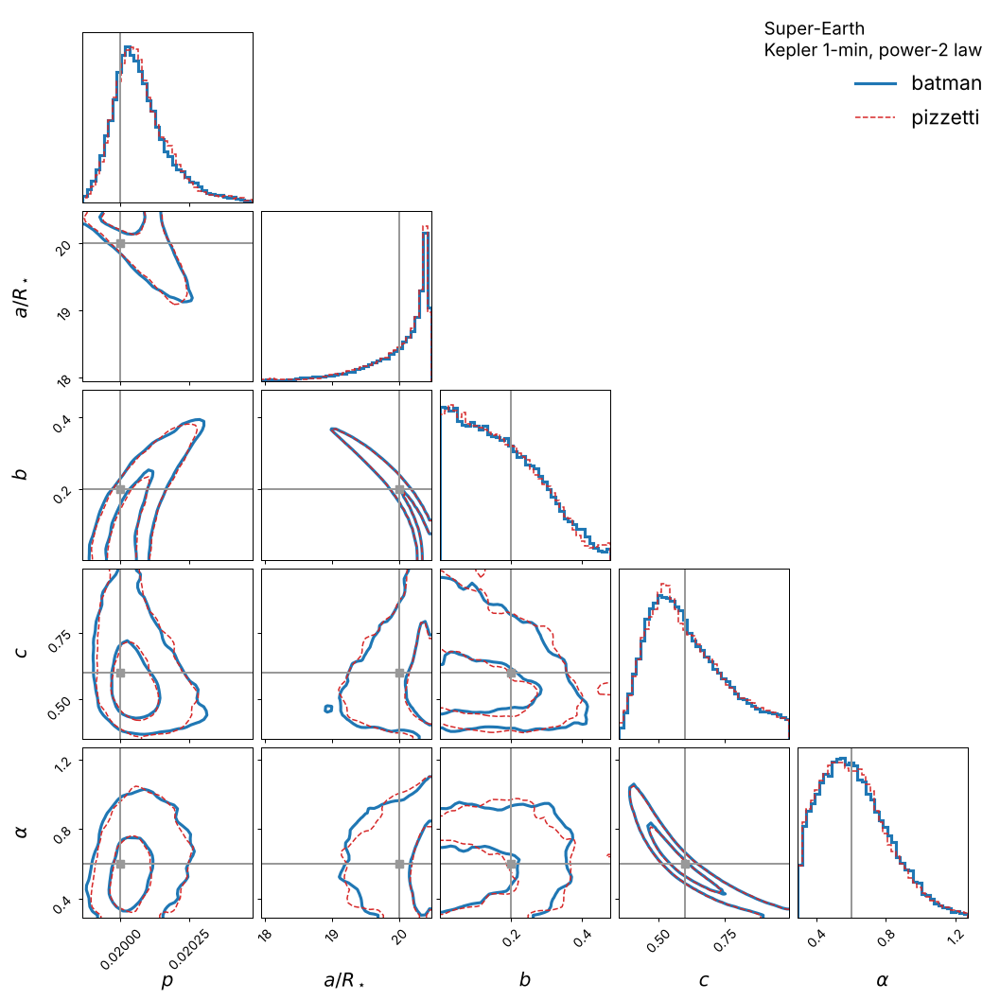

# pizzetti

**Fast limb-darkened transit light curves, with an elementary series and a proven error bound.**

`pizzetti` computes exoplanet (and exomoon) transit light curves through the same interface as
[batman](https://github.com/lkreidberg/batman). Code written for batman runs unchanged after a
one-line change:

```python
import pizzetti as batman
```

## Why it is fast

Since Mandel & Agol (2002), transit codes have evaluated complete elliptic integrals of all three
kinds, or integrated the stellar disk numerically, at every point of the light curve. `pizzetti`
does not need any of that for the main part of a transit.

While the planet is entirely inside the stellar disk, between second and third contact, the flux
has an **elementary** form: `sqrt(1 - z²)` times a polynomial in `1/(1 - z²)`. Its coefficients
depend only on the radius ratio, so they are computed once per light curve. Each in-transit point
then costs **one square root, one division and a dozen multiply–adds**. There are no branches, no
iterations and no special cases.

| | elliptic-integral solution | pizzetti interior series |
|---|---|---|
| square roots + divisions per point | ~14 | **2** |
| time per point (vectorised, numba) | 10.8 ns | **0.97 ns** |

For an Earth-sized planet crossing a Sun-like star, the series covers **96–98 %** of the
in-transit points (central transit: 98 %; averaged over impact parameters: 96 %). The few points that touch the stellar limb use an exact, vectorised Mandel & Agol solver
(uniform, linear and quadratic laws) or, for the other laws, power series about first and second contact with
coefficients computed once per light curve (accurate to ~1e-15, 15-22x faster per sample than quadrature, radius
ratios up to ~0.2). Short light curves and larger occulters use a Green's-theorem quadrature with a
Gauss–Jacobi rule for the endpoint singularity at the limb (~1e-16).

## Proven correctness

- **The error bound is proven, not estimated.** All terms of the series have the same sign, which
  gives a closed-form bound on the truncation error. The bound increases monotonically along the
  transit chord, so a single cut per light curve guarantees the requested accuracy. The default
  is 10⁻⁹ of the stellar flux, i.e. 0.001 ppm.
- **It is verified against a 40-digit reference.** Every law agrees with an independent mpmath
  quadrature to **2 × 10⁻⁹**, including points within 10⁻¹⁵ of the contact points, at z = 0 and
  at z = rp.
- **It is more accurate than batman.** For the power-2 and nonlinear laws batman's adaptive
  integration leaves errors of ~10⁻⁷ even at its tightest setting; `pizzetti` stays below 10⁻⁹.
  Kepler's equation is solved to 10⁻¹⁵ instead of 10⁻⁷.
- **The limb can be proven too.** With `limb="proven"` the contact expansions are split into
  pieces whose degrees are chosen so that their flux error is also proven to be below `series_tol`
  (radius ratios up to ~0.2 at 10⁻⁹, ~0.15 at 10⁻¹²). The proof costs 5–60 ms of set-up per light
  curve, so it is opt-in; `occult(..., return_certified=True)` reports which samples it covers.
  The default (`limb="fast"`) uses the same expansions at fixed order with an estimated error of ~10⁻¹⁵.

## Inference

Same posterior, less time. Two synthetic data sets were fitted with emcee, once with batman and once
with pizzetti, with identical likelihoods, starting positions and random numbers
([examples/inference](examples/inference), paper Section 6.4):

| | hot Jupiter, TESS 2-min, quadratic law | super-Earth, Kepler 1-min, power-2 law |
|---|---|---|
| largest difference of the posterior medians | 0.08 σ | 0.04 σ |
| model error over the posterior, batman / pizzetti | 9 × 10⁻⁹ / 7 × 10⁻¹⁰ | 1.9 × 10⁻⁶ / 5 × 10⁻¹⁰ |
| one likelihood evaluation, batman / pizzetti | 0.104 / 0.040 ms (**2.6×**) | 0.82 / 0.48 ms (**1.7×**) |
| 2000-step emcee run, batman / pizzetti | 8.4 / 3.6 s | 51 / 27 s |

The posteriors agree within their Monte Carlo noise. To come close to pizzetti's accuracy for the
power-2 law, batman needs `max_err=0.01`, at 4.6 ms per evaluation (still off by 4 × 10⁻⁸). The
Julia version computes the gradient of either likelihood with respect to all seven parameters in
about ten likelihood evaluations ([julia/](julia)).

Notebooks: [drop-in replacement in an emcee fit](examples/01_batman_dropin_emcee.ipynb),
[power-2 super-Earth](examples/02_power2_superearth.ipynb).



## Speed against batman

Single thread, 10⁵ points, about 30 % of them in transit (`benchmarks/benchmark.py`, Intel Xeon
2.1 GHz, numba 0.68). "Full" means that every call also recomputes the orbit, as in a fit.

| law | rp | batman | pizzetti | speed-up | batman (full) | pizzetti (full) | speed-up |
|---|---|---|---|---|---|---|---|
| quadratic | 0.0092 | 1.61 ms | 0.27 ms | **6.0×** | 3.77 ms | 0.58 ms | **6.6×** |
| quadratic | 0.1 | 2.07 ms | 0.38 ms | **5.4×** | 4.27 ms | 0.56 ms | **7.6×** |
| nonlinear | 0.0092 | 2.23 ms | 0.99 ms | 2.3× | 5.40 ms | 1.19 ms | 4.5× |
| nonlinear | 0.1 | 46.7 ms | 2.16 ms | **22×** | 48.7 ms | 2.47 ms | **20×** |
| power2 | 0.0092 | 1.31 ms | 0.78 ms | 1.7× | 3.97 ms | 1.07 ms | 3.7× |
| power2 | 0.1 | 26.6 ms | 1.12 ms | **24×** | 24.3 ms | 1.31 ms | **19×** |

batman's numerical laws (nonlinear, power2) run at its default tolerance of 1 ppm; pizzetti's
errors stay below 10⁻⁹. In a complete emcee fit the likelihood is 1.7–2.6 times faster
([examples/inference](examples/inference)).

## Installation

```bash
pip install pizzetti  # recommended
pip install git+https://github.com/hippke/pizzetti  # latest dev build
```

Requirements: Python ≥ 3.9, NumPy, numba. The first call compiles the kernels (a few seconds);
they are cached on disk afterwards.

## Usage

```python
import pizzetti
import numpy as np
import matplotlib.pyplot as plt

params = pizzetti.TransitParams()
params.t0 = 0.0          # time of inferior conjunction
params.per = 3.0         # orbital period
params.rp = 0.1          # planet radius (stellar radii)
params.a = 15.0          # semi-major axis (stellar radii)
params.inc = 88.0        # inclination (degrees)
params.ecc = 0.0         # eccentricity
params.w = 90.0          # argument of periapse (degrees)
params.u = [0.4, 0.25]   # limb-darkening coefficients
params.limb_dark = "quadratic"

t = np.linspace(-0.1, 0.1, 10_000)
m = pizzetti.TransitModel(params, t)
flux = m.light_curve(params)

plt.plot(t, flux)
plt.xlabel("Time from mid-transit (days)")
plt.ylabel("Relative flux")
plt.show()
```

The low-level function works on separations directly:

```python
z = np.linspace(0, 1.2, 1000)                     # projected separation (stellar radii)
f = pizzetti.occult(z, 0.1, [0.4, 0.25], "quadratic")
z_c = pizzetti.series_cut(0.1, "quadratic", [0.4, 0.25])   # series used for z <= z_c
```

### batman features supported

- `TransitParams` and `TransitModel` with the same attributes and methods: `light_curve`,
  `get_t_periastron`, `get_t_secondary`, `get_t_conjunction`, `get_true_anomaly` and `calc_err`.
- Limb-darkening laws: `uniform`, `linear`, `quadratic`, `squareroot`, `nonlinear` (four-parameter)
  and `power2`.
- Circular and eccentric orbits, supersampling (`supersample_factor`, `exp_time`), secondary
  eclipses (`transittype="secondary"`, `fp`, `t_secondary`) and inverse transits (`rp < 0`).
- Not supported: the `logarithmic`, `exponential` and `custom` laws. They are not sums of powers
  of μ, so `pizzetti` raises `NotImplementedError` for them.

## Examples and inference

[`examples/`](examples/) has notebooks that fit synthetic TESS- and Kepler-like light curves with emcee,
once with batman and once with pizzetti (same likelihood, starting points and random numbers). The posteriors
agree within their Monte Carlo noise; the likelihood evaluations are 2.4x (quadratic law, hot Jupiter) and
1.4x (power-2 law, super-Earth) faster, and pizzetti's model error over the posterior is below 1e-9, against
9e-9 and 1.9e-6 for batman. See [`examples/inference`](examples/inference) for the full runs.

## Julia

[`julia/`](julia/) contains **Pizzetti.jl**, a Julia implementation of the same methods with
ForwardDiff support (exact derivatives of the flux from the paper's Section 5.4), BigFloat evaluation,
rigorous interval enclosures, and Limbdark.jl's `transit_poly` interface.

## Documentation

The full documentation, covering the method, the accuracy proofs and checks, the benchmarks and
the API, is on [Read the Docs](https://pizzetti.readthedocs.io) and in `docs/`.

## The name *pizzetti*

The series is the two-dimensional form of the mean-value expansion of **Paolo Pizzetti**
(1860–1918). He gave the mean of a function over a sphere as a series of its iterated Laplacians,
with an exact remainder (*Rend. Lincei* 18, 1909). Pizzetti was an Italian geodesist and
mathematician; geodesists still use the Somigliana–Pizzetti formula for normal gravity on the
reference ellipsoid. A century later, his formula turns the transit of a planet into a polynomial.

## Citing

If you use `pizzetti`, please cite the accompanying paper (in preparation) and Mandel & Agol
(2002). See `CITATION.cff`.
