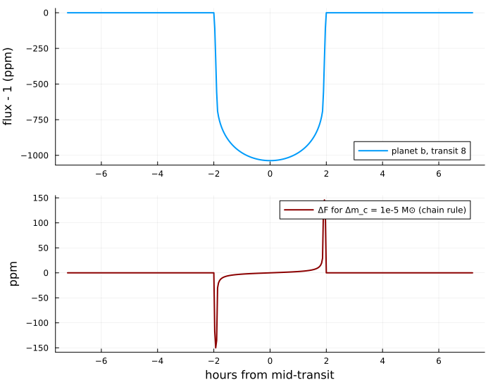

# Pizzetti.jl

**Limb-darkened transit light curves from an elementary series with a proven error bound, in Julia.**

Pizzetti.jl implements the methods of Hippke & Agol (in prep.) and of the Python package
[pizzetti](https://github.com/hippke/pizzetti) in Julia:

- **Interior series.** While the occultor lies inside the stellar disk, the flux of any law built
  from powers of μ is `w^γ` times a polynomial in `v = 1/(1 - z²)` (Pizzetti's mean-value
  expansion). Its truncation error has a closed-form bound (Theorem 2), so one cut `z_c` per light
  curve guarantees a prescribed tolerance (default `1e-9`). Cost: one square root, one division and
  a dozen multiply-adds per sample, in a SIMD loop.
- **Near and across the limb.** The exact Mandel & Agol (2002) solution for the quadratic family;
  for the other laws, power series about first and second contact built from Gauss hypergeometric
  functions (`~1e-15`), optionally split into pieces with a **proven** bound (Theorem 3), or
  Green's-theorem quadrature with a Gauss–Jacobi first segment (`~1e-16`).
- **Exact derivatives.** With ForwardDiff, dual numbers flow through orbits and light curves; the
  flux derivatives with respect to `z` and `p` are the closed-form hypergeometric expressions of the
  paper (Section 5.4), not derivatives of truncated series or of quadrature rules.
- **Any precision.** Everything is generic: `BigFloat` light curves (with a higher series order),
  and rigorous `IntervalArithmetic` enclosures of the exact interior flux, including rounding.
- **Drop-in for Limbdark.jl.** `transit_poly(r, b, u_n)` and `transit_poly!(r, b, u_n, dfdrbu)` with
  the same arguments and the same polynomial law; for degrees ≤ 2 the flux and its gradient come
  from closed forms (~100 ns per call with the gradient).

```julia
julia> using Pizzetti

julia> occult([0.0, 0.5, 0.95, 1.05], 0.1, Power2(0.6, 0.6))     # flux at separations z
4-element Vector{Float64}:
 0.9884033280505852
 0.9889845552077373
 0.9934649431396444
 0.9986520901005472
```

## Installation

From the repository (the package lives in the `julia/` folder):

```julia
using Pkg
Pkg.add(url = "https://github.com/hippke/pizzetti", subdir = "julia")
```

Requirements: Julia ≥ 1.10, SpecialFunctions. ForwardDiff and IntervalArithmetic are optional
(package extensions load when they are loaded).

## Usage

### Laws

| law | intensity |
|---|---|
| `Uniform()` | `1` |
| `Linear(u1)` | `1 - u1 (1 - μ)` |
| `Quadratic(u1, u2)` | `1 - u1 (1 - μ) - u2 (1 - μ)²` |
| `SquareRoot(u1, u2)` | `1 - u1 (1 - μ) - u2 (1 - √μ)` |
| `Nonlinear(c1, c2, c3, c4)` | `1 - Σ cₙ (1 - μ^(n/2))` (Claret 2000) |
| `Power2(c, α)` | `1 - c (1 - μ^α)` |
| `Polynomial(u)` | `1 - Σ uₙ (1 - μ)ⁿ` (Agol, Luger & Foreman-Mackey 2020) |
| `PowerSum(α, c)` | `Σ cᵢ μ^αᵢ` |

`limb_darkening("power2", [0.6, 0.6])` builds a law from batman's names.

### Flux

```julia
f = occult(z, p, law)                       # vector of separations
o = Occultor(p, law)                        # set-up once per (p, law) ...
f = o.(z)                                   # ... then evaluate (or evaluate!(out, o, z))
method(o, 0.95)                             # :series, :quadratic, :contact, :proven or :quadrature
series_cut(p, law; series_tol = 1e-9)       # z_c: the series is used, with a proven bound, for z ≤ z_c
```

Keywords: `series_tol` (proven bound of the interior series; `0` switches it off), `limb`
(`:auto`, `:fast`, `:quadrature`, `:proven`), `M` (series order, odd; raise it for `BigFloat`).

### Light curves

```julia
prm = TransitParams(per = 3.5, rp = 0.1, a = 9.0, b = 0.35, law = Quadratic(0.40, 0.25))
flux = light_curve(t, prm)                                      # Keplerian orbit (batman conventions)
flux = light_curve(t, prm; exp_time = 30 / 1440, supersample = 7)   # exposure integration
z = rsky(t, prm)                                                # projected separations
```

`TransitParams` also takes `inc` (degrees) instead of `b`, `ecc`, `w`, and batman's `u` and
`limb_dark`.

### Derivatives

```julia
using ForwardDiff
ForwardDiff.gradient(v -> sum(light_curve(t, TransitParams(per = 3.5, rp = v[1], a = v[2], b = v[3],
                                                           law = Power2(v[4], v[5])))), [0.1, 9, 0.3, 0.6, 0.6])

F, dFdz, dFdp, dFdc = flux_gradient(z, p, law)       # exact, without automatic differentiation
F, dFdz, dFdp, dFdu = flux_gradient_law(z, p, law)   # with respect to the law's parameters
```

Under ForwardDiff the value is computed as usual (series within its proven bound, contact
expansions, closed forms), and the partial derivatives with respect to `z` and `p` come from
the exact expressions of the paper's Section 5.4 everywhere, including the interior (where the
derivative of the truncated series would only be accurate to ~1e-7 near the cut) and exactly at the
contact points (where automatic differentiation of the elliptic integrals or of a quadrature rule
fails). Derivatives with respect to exponents (the power-2 α) are Richardson-extrapolated
differences of the contact expansions or the quadrature (~1e-12). Nested duals (Hessians) use
plain automatic differentiation.

### Proven accuracy

```julia
f, certified = occult_certified(z, p, law; series_tol = 1e-9)   # proven pieces at the limb too

using IntervalArithmetic
I = occult_interval(0.3, 0.1, Power2(0.6, 0.6))   # contains the exact flux, rounding included
```

`occult_certified` uses the pieces of Theorem 3 near the limb and reports which samples carry a
proven bound (all of them for `p ≤ 0.2` at `1e-9`, `p ≤ 0.15` at `1e-12`). `occult_interval`
evaluates the interior series in interval arithmetic with the exact rational coefficient table
and adds the Theorem-2 bound: the result is an interval that contains the true flux.

### Limbdark.jl interface

```julia
transit_poly(r, b, u_n)                 # flux
transit_poly!(r, b, u_n, dfdrbu)        # flux, and dfdrbu = [∂F/∂r, ∂F/∂b, ∂F/∂u_1, ...]
```

## Examples

`examples/` (run from that folder with `julia --project=. <file>`):

| script | content |
|---|---|
| `01_quickstart.jl` | laws, methods per sample, light curves with exposure time, derivatives, BigFloat |
| `02_gradient_fit.jl` | Kepler-like super-Earth with the power-2 law: gradient check, Nelder–Mead vs L-BFGS with ForwardDiff, Hessian uncertainties |
| `03_photodynamics.jl` | two planets near 2:1 with NbodyGradient.jl: transit times, impact parameters and sky velocities with their derivatives, chained with Pizzetti's exact ∂F/∂z into the derivative of every light-curve sample with respect to every initial orbital element and mass; checked against finite differences of the whole pipeline |
| `04_certified.jl` | certified light curves, interval enclosures, Theorem 2 against BigFloat |
| `05_limbdark.jl` | fluxes and gradients against Limbdark.jl, timing |



## Accuracy and tests

`test/` (2820 tests, `] test Pizzetti`):

- against the **independent references** of [`testdata/`](../testdata): the blocked integral by
  tanh-sinh quadrature of the area integral (no series, no Green's theorem, no hypergeometric
  functions), in double precision for 11 exponents × 7 radius ratios including the contacts
  (every limb method within 3e-15 of the stellar flux; the series within its tolerance), and a
  30-digit subset (BigFloat quadrature within 1e-28);
- Theorem 2 (bound and one-sidedness) in BigFloat; the hypergeometric functions against
  HypergeometricFunctions.jl; the Python package (proven-mode certification identical sample by
  sample; light curves and orbits);
- all derivatives against finite differences and BigFloat differences, exactly at the contacts too;
- interval enclosures contain 60-digit values; Aqua.jl package checks.

## Speed

Single thread, Intel Xeon 2.1 GHz, Julia 1.13 (`benchmark/benchmarks.jl`, results in
`benchmark/results.md`). Per sample:

| | quadratic | power-2 | nonlinear |
|---|---|---|---|
| interior series (SIMD) | 1.6 ns | 3.3 ns | 2.4 ns |
| contact expansions | — | 55 ns | 93 ns |
| quadrature (Gauss–Jacobi) | — | ~1 µs | ~1.7 µs |
| exact quadratic solution | 43 ns | — | — |

Set-up per light curve: ~5 µs (series cut and coefficients); contact expansions 0.06–0.4 ms
(used only for light curves with enough limb samples); proven pieces 6–37 ms.

The likelihoods of the paper's inference example (`benchmark/inference_cases.jl`, a new posterior
sample at every call):

| | hot Jupiter, quadratic, 1316 samples | super-Earth, power-2, 10 380 samples |
|---|---|---|
| likelihood (orbit, light curve, χ²) | 0.039 ms | 0.41 ms |
| gradient, 7 parameters (ForwardDiff) | 0.40 ms | 4.1 ms |
| for comparison: Python pizzetti / batman | 0.040 / 0.104 ms | 0.48 / 0.82 ms |

Against Limbdark.jl (quadratic law, p = 0.1, 10 000 samples): a light curve costs 0.13 ms
(Limbdark.jl 0.48 ms with its work structure re-used); a light curve with the gradient
`[∂F/∂r, ∂F/∂b, ∂F/∂u₁, ∂F/∂u₂]` at every sample 1.1 ms in both; a single `transit_poly` call
29 ns (1.5 µs). Fluxes agree to 5e-15 and gradients to 1e-14, except within 1e-16 of a contact,
where the derivative has a √δ term and both codes are limited by the rounding of their input.

## Citing

Please cite the accompanying paper (Hippke & Agol, in prep.), Mandel & Agol (2002) and, for the
polynomial interface, Agol, Luger & Foreman-Mackey (2020).
